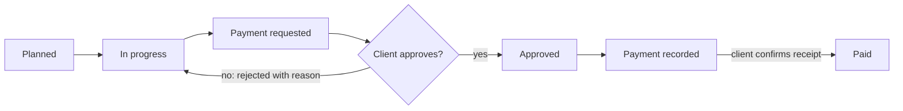
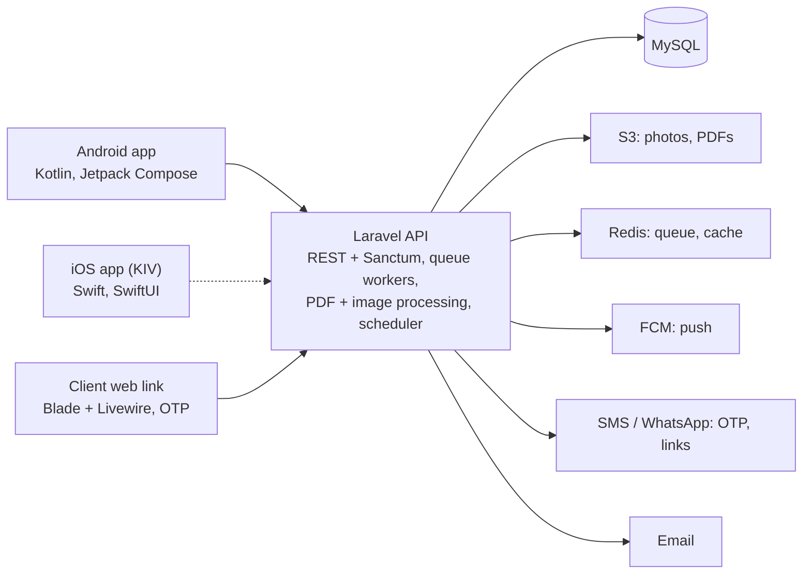

# Job Progress Claims App — Product & Technical Spec

Version: 12 Oct 2026

## Overview

The app lets a small contractor split any job into paid milestones, prove each one with photos, and get the client's approval on record before the next payment. Working name: **JobProof**.

**Problem.** On small jobs, scope, progress and payments live in WhatsApp chats and memory. Disputes start when the client says work isn't done, extra work was never agreed, or a payment was already made.

**Who it's for.** Small contractors and tradespeople running jobs worth roughly RM 5,000 to RM 500,000, and their clients:

- House building and extensions
- Renovation and interior fit-out
- Roofing, plumbing, electrical and aircon installation
- Landscaping, fencing, swimming pools
- Any job that is paid in stages

**Core idea.** Every job has a quote, milestones that add up to it, photo proof per milestone, a client approval per payment request, signed variation orders for extra work, and a payment ledger. Both sides see the same record.

**What it is not.** Not a payment processor, not escrow, not full project-management software with Gantt charts. Payments happen outside the app; the app records them.

## Roles and permissions

The MVP ships with two roles, contractor and client. Workers and subcontractors come in phase 2, and the schema reserves room for them from day one.

| Role | Phase | Signs in with | Can do | Cannot do |
| --- | --- | --- | --- | --- |
| Contractor (owner) | MVP | Mobile app, email + password | Create jobs, milestones, variation orders; upload proof; request payment; record payments; invite clients | — |
| Client | MVP | Web link + phone OTP, no app needed | View job, approve or reject payment requests, sign variation orders, confirm payments, comment | Edit quote, milestones or photos |
| Worker / site staff | Phase 2 | Mobile app, invited by contractor | Upload photos and daily logs to assigned jobs | See prices, request payment, talk to client |
| Subcontractor | Phase 2 | Mobile app, invited by contractor | Own milestones under a main job, submit claims to the main contractor | See the main contract value or other subs' claims |

A contractor account is a **company** (tenant). Phase 2 adds more contractor-side users to the same company with the role column deciding access.

## Core concepts and user flows

A job is a quote split into milestones; each milestone moves through one approval loop, and extra work enters only through a signed variation order.

| Concept | What it is | Key rule |
| --- | --- | --- |
| Job | One contract with one client: site address, quote total, start and target dates | Quote total is locked once the client accepts the job |
| Milestone | A stage of the job with a name, % or fixed amount, and due date | Milestones must sum to the quote plus approved variations |
| Proof | Photos, notes and optional files attached to a milestone | Photos are timestamped and geotagged at capture; no editing after submit |
| Payment request | A request to the client to pay a milestone | One open request per milestone at a time |
| Variation order (VO) | Extra or removed work with a price and reason | Counts toward the job total only after the client signs |
| Payment | Money received, recorded by the contractor | Client confirms it, so both sides agree on the balance |

A rejection always carries the client's reason and sends the milestone back to In progress; every step is logged with who did it and when.

**Job setup**

1. Contractor creates the job: client name and phone, site address, quote total, dates.
2. Contractor adds milestones, picking a template (house build, renovation, installation) or writing their own.
3. Client gets a WhatsApp/SMS link, verifies by OTP, and accepts the job and milestone schedule.

**Variation order**

1. Either side raises extra work; the contractor writes the VO with description, price and photos.
2. Client signs or rejects in the web link.
3. A signed VO adds a new milestone or adjusts an existing one, and the job total updates.

## Screens

The contractor works in a native Android app (Kotlin); the client never installs anything and uses a mobile-friendly web link.

**Contractor app (Android), MVP**

| Screen | What it shows | Main actions |
| --- | --- | --- |
| Login / sign-up | Email, password, company name | Register, log in, reset password |
| Jobs list | Active jobs with progress bar, amount paid vs total, next due milestone | Search, filter by status, new job |
| New job | Client, site address, quote total, dates, milestone template | Save draft, send to client |
| Job detail | Milestones with status chips, balance summary, VO list, activity feed | Open milestone, new VO, record payment, share link |
| Milestone detail | Amount, due date, proof gallery, client comments, history | Take photos, add notes, request payment |
| Camera / proof capture | In-app camera with timestamp and GPS stamp, multi-shot | Capture, caption, upload (queued offline) |
| Variation order form | Description, price (+/−), photos, reason | Send to client for signing |
| Record payment | Amount, date, method (transfer, cash, cheque), reference, receipt photo | Save, client gets confirm request |
| Notifications | Approvals, rejections, signatures, confirmations | Tap through to the item |
| Settings | Company profile, logo, bank details shown to clients, plan | Edit, upgrade |

**Client web link (no install)**

| Screen | What it shows | Main actions |
| --- | --- | --- |
| OTP verify | Phone number check | Enter code |
| Job overview | Contractor, total, paid, balance, milestone timeline | Accept job (first visit) |
| Payment request | Milestone, amount, proof photos full-screen, contractor bank details | Approve, reject with reason |
| Variation order | Description, price, photos | Sign (typed name + checkbox, or finger signature), reject |
| Payment confirm | Amount and reference the contractor recorded | Confirm, dispute |
| Job record PDF | Full history: milestones, photos, VOs, approvals, payments | Download |

**Web admin (contractor, desktop)** is a phase-2 convenience: the same job data in tables, bulk PDF export, and company users. The MVP can live without it because the mobile app covers every action.

## Architecture

One Laravel API serves the Android app and the client web link, so all business rules (who can approve, what totals are valid) live in one place.

The apps never touch storage or messaging directly; photos upload through short-lived S3 pre-signed URLs issued by the API.

- **Offline capture.** Sites often have weak signal. The Android app stores photos and notes in a local queue (Room + WorkManager; the same pattern applies to iOS if it is built later) and sync when online. Capture time and GPS come from the device at the moment of shooting, not at upload.
- **Tamper evidence.** On upload the API stores the original file, a SHA-256 hash and capture metadata; thumbnails are separate files. Proof can't be edited after a payment request is sent.
- **Multi-tenant.** Every table carries `company_id`; a global scope enforces it. One database for the MVP.
- **Client auth.** A signed link token identifies the job; phone OTP proves the person. Session lasts 30 days on that device.
- **Hosting.** One app server + managed MySQL + S3-compatible storage is enough for the first few hundred contractors.

## Database schema

Fourteen tables cover the MVP; the three marked phase 2 are created empty so workers and subcontractors slot in without a migration rewrite. Money is stored as integer sen (`amount_cents`) to avoid rounding errors.

| Table | Key columns | Notes |
| --- | --- | --- |
| `companies` | id, name, logo_path, bank_name, bank_account_name, bank_account_no, plan, trial_ends_at | The contractor tenant |
| `users` | id, company_id, name, email, phone, password, role (`owner`, `worker`, `subcontractor`) | Only `owner` in MVP |
| `clients` | id, company_id, name, phone, email | Reused across jobs |
| `jobs` | id, company_id, client_id, title, site_address, lat, lng, quote_cents, status (`draft`, `sent`, `active`, `completed`, `cancelled`), start_date, target_date, accepted_at, share_token | `share_token` drives the client link |
| `milestones` | id, job_id, variation_order_id (nullable), sequence, name, description, amount_cents, due_date, status (`planned`, `in_progress`, `requested`, `approved`, `rejected`, `paid`), assigned_user_id (phase 2) | Sum must equal quote + signed VOs |
| `proofs` | id, milestone_id, uploaded_by, type (`photo`, `file`, `note`), path, thumb_path, sha256, captured_at, lat, lng, caption | Immutable after the request is sent |
| `payment_requests` | id, milestone_id, amount_cents, note, status (`open`, `approved`, `rejected`, `withdrawn`), decided_at, decided_by_client_id, reject_reason | History of every attempt |
| `variation_orders` | id, job_id, number, description, amount_cents (negative allowed), status (`draft`, `sent`, `signed`, `rejected`), signed_at, signature_path, signer_name, reject_reason | `number` is VO-001, VO-002 per job |
| `vo_attachments` | id, variation_order_id, path, sha256 | Photos, drawings |
| `payments` | id, job_id, milestone_id (nullable), amount_cents, paid_on, method (`transfer`, `cash`, `cheque`, `other`), reference, receipt_path, client_status (`pending`, `confirmed`, `disputed`), confirmed_at | Partial payments allowed |
| `comments` | id, commentable_type, commentable_id, author_type, author_id, body | On milestones, requests, VOs |
| `activity_log` | id, company_id, job_id, actor_type, actor_id, action, subject_type, subject_id, meta (json), ip, created_at | Append-only audit trail |
| `client_sessions` | id, client_id, job_id, phone, otp_hash, otp_expires_at, device_token, verified_at | Client web login |
| `device_tokens` | id, user_id, platform (`android`, `ios`), token | Push notifications |
| `daily_logs` (phase 2) | id, job_id, user_id, log_date, weather, workers_on_site, notes | Site diary |
| `subcontracts` (phase 2) | id, job_id, subcontractor_user_id, scope, amount_cents, status | Sub's milestones link here |
| `job_members` (phase 2) | job_id, user_id, role | Which workers see which jobs |

**Key invariants (enforced in the service layer, tested):**

- A milestone can move to `requested` only with at least one proof.
- Proofs on a milestone are read-only while a request is `open` or after `approved`.
- Sum of milestone amounts = `quote_cents` + sum of signed VO amounts.
- A job is `completed` when every milestone is `paid` and the client has confirmed every payment.

## API endpoints

Two route groups: `/api/v1/*` for the contractor apps (Sanctum bearer token) and `/c/{share_token}/*` for the client link (OTP session). All responses are JSON except PDF downloads.

**Contractor API (`/api/v1`, auth: Sanctum)**

| Method | Path | Purpose |
| --- | --- | --- |
| POST | /auth/register | Create company + owner |
| POST | /auth/login | Get token |
| POST | /auth/logout | Revoke token |
| GET | /me | User + company + plan |
| PUT | /company | Update profile, logo, bank details |
| GET | /clients | List clients |
| POST | /clients | Create client |
| GET | /jobs?status= | List jobs with totals |
| POST | /jobs | Create job (with milestones from template) |
| GET | /jobs/{id} | Job detail with milestones, VOs, payments, balance |
| PUT | /jobs/{id} | Edit draft job |
| POST | /jobs/{id}/send | Send link to client |
| POST | /jobs/{id}/milestones | Add milestone |
| PUT | /milestones/{id} | Edit milestone (blocked once requested) |
| POST | /milestones/{id}/start | Planned → in progress |
| POST | /milestones/{id}/proofs/upload-url | Get S3 pre-signed URL |
| POST | /milestones/{id}/proofs | Register uploaded proof (path, sha256, captured_at, lat, lng) |
| DELETE | /proofs/{id} | Remove proof (only before request) |
| POST | /milestones/{id}/payment-requests | Request payment |
| POST | /payment-requests/{id}/withdraw | Withdraw open request |
| POST | /jobs/{id}/variation-orders | Create VO |
| POST | /variation-orders/{id}/send | Send VO for signing |
| POST | /jobs/{id}/payments | Record payment |
| GET | /jobs/{id}/activity | Audit trail |
| GET | /jobs/{id}/record.pdf | Full job record PDF |
| POST | /comments | Comment on milestone, request or VO |
| POST | /devices | Register push token |
| GET | /milestone-templates | Built-in templates |

**Client link (`/c/{share_token}`, auth: OTP session)**

| Method | Path | Purpose |
| --- | --- | --- |
| POST | /otp/send | Send OTP to the job's client phone |
| POST | /otp/verify | Start session |
| GET | / | Job overview |
| POST | /accept | Accept job and schedule |
| GET | /payment-requests/{id} | Request with proofs |
| POST | /payment-requests/{id}/approve | Approve |
| POST | /payment-requests/{id}/reject | Reject with reason (required) |
| GET | /variation-orders/{id} | VO detail |
| POST | /variation-orders/{id}/sign | Sign (name + signature image) |
| POST | /variation-orders/{id}/reject | Reject with reason |
| POST | /payments/{id}/confirm | Confirm payment |
| POST | /payments/{id}/dispute | Dispute with note |
| GET | /record.pdf | Download job record |

**Events → notifications** (queued): `JobSent`, `PaymentRequested`, `PaymentRequestDecided`, `VariationOrderSent`, `VariationOrderDecided`, `PaymentRecorded`, `PaymentConfirmed`, `MilestoneDueSoon` (scheduler, 3 days before due). Contractor gets push; client gets SMS/WhatsApp with the link, plus email if on file.

## Scope, pricing, timeline and risks

Ship the API, Android app and client link in about 10 weeks solo. iOS is KIV: target contractors mostly use Android, so it waits until Android proves demand; clients use the web link, so their phone doesn't matter.

**MVP vs phase 2**

| Feature | MVP | Phase 2 |
| --- | --- | --- |
| Jobs, milestones, templates | Yes | Custom saved templates |
| Photo proof with time + GPS, offline queue | Yes | Video proof |
| Payment requests + client approve/reject | Yes | — |
| Variation orders with signature | Yes | — |
| Payment recording + client confirmation | Yes | Online payment via gateway |
| Job record PDF | Yes | Branded PDF themes |
| Client web link with OTP | Yes | — |
| Android app | Yes | — |
| iOS app | KIV, after Android pilot | — |
| Workers: photo upload, daily logs | — | Yes |
| Subcontractors: own milestones and claims | — | Yes |
| Web admin dashboard | — | Yes |
| Retention sum held until defects period ends | — | Yes |

**Pricing (RM, monthly per company)**

| Plan | Price | Limits |
| --- | --- | --- |
| Free | RM 0 | 1 active job, 5 GB photos |
| Solo | RM 49 | 10 active jobs, 50 GB |
| Team (phase 2) | RM 129 | Unlimited jobs, 5 workers, subcontractors |

Clients never pay and never need an account; that keeps the client side frictionless and makes every client a viewer of the brand.

**Build plan (one developer)**

1. Weeks 1–3: Laravel API, schema, auth, jobs, milestones, proofs, S3 uploads, tests for the invariants.
2. Weeks 4–7: Android app: jobs, milestone detail, camera with offline queue, payment requests, VOs, payments, push.
3. Weeks 8–9: Client web link: OTP, approve/reject, VO signing, payment confirm, PDF record.
4. Week 10: Pilot with 3–5 contractors on live jobs; fix what they hit.
5. Week 11 onward: onboard paying contractors and start phase 2 (workers, subcontractors). iOS app stays KIV until enough iPhone contractors ask for it.

**Risks**

| Risk | Mitigation |
| --- | --- |
| Contractors won't change from WhatsApp | Client gets the link over WhatsApp; the app adds a record, not a new channel. Free tier for the first job. |
| Clients ignore the link | Reminder after 48 hours; contractor can mark "approved verbally" with a note, flagged as such in the record. |
| Photo storage cost grows fast | Compress to ~1600 px on device, keep original only for the latest proof set, lifecycle older files to cheaper storage. |
| Disputes over whether app records hold up | Position it as evidence and a paper trail, not a legal contract; hashes and the audit log make tampering visible. |
| Some contractors use iPhones | Android first; iOS only after pilot shows enough iPhone contractors ask for it. Clients are unaffected since they use the web link. |

## Local development (MAMP)

MAMP provides PHP and MySQL only. Use these stand-ins locally; production switches by config, not code.

| Production | Local (MAMP) |
| --- | --- |
| Redis queue + Horizon | `QUEUE_CONNECTION=database`, run `php artisan queue:work` |
| S3 storage | `FILESYSTEM_DISK=local`, always via the `Storage` facade |
| SMS / WhatsApp / email | `MAIL_MAILER=log` and a log-only SMS driver behind an interface |
| FCM push | Log-only driver until the Android app exists |

Build order for the backend: follow the build plan above, one phase at a time.
